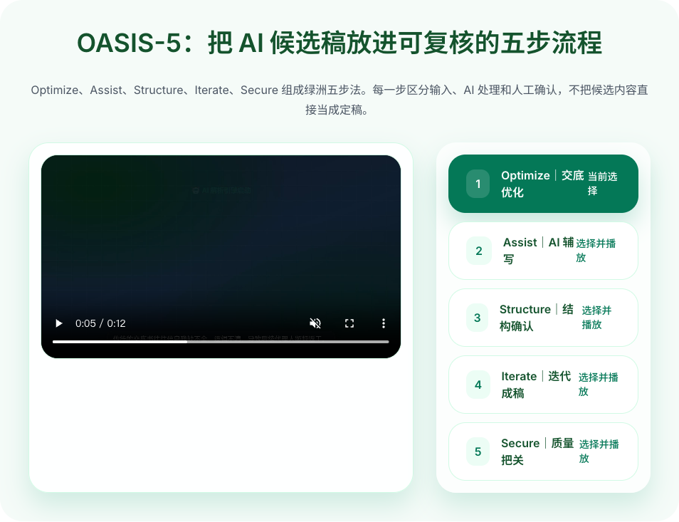

# 绿洲慧写 · OasisIntWrite

**把发明人的反馈整理成可追溯的改稿依据，把需要人判断的问题留给专业人员。**

这里汇集了绿洲慧写公开的专利工作规则、Dify 工作流设计和本地协作工具。你可以按手头任务选一条规则试读，也可以从流程设计和部署条件开始评估。

[免登录看演示](#免登录试用) · [找一条专利规则](https://github.com/Tina-patentpro/oasis-patent-skills) · [看工作流怎么设计](https://github.com/Tina-patentpro/oasis-dify-workflows) · [咨询演示与部署](https://oasisintwrite.com/contact/)

## 免登录试用

1. [打开官网五步演示](https://oasisintwrite.com/#oasis-5)。先点 **Optimize｜交底优化**，看怎样把原始材料和需要确认的问题分开。
2. 再点 **Structure｜结构确认** 或 **Secure｜质量把关**，查看后续环节。可先看 [8 秒操作动图](docs/demo/oasis-five-steps.gif)。
3. 想自己试读，就用下方的虚构反馈对照 [M10 技术沟通与确认](https://github.com/Tina-patentpro/oasis-patent-skills/blob/ff5caabbdc3c29a2c703bacb193450d495ee6c4a/skills/patent-technical-confirmation/SKILL.md)，写出一条追问、一条待确认项。

以上体验无需登录或上传文件。[在线工作台](https://app.oasisintwrite.com/) 需登录，运行任务前请查看界面所示价格。

## 从一条发明人反馈开始

假设发明人补充：“样机外壳已经换成铝材，耐热测试还没做。”下面用这条**虚构示例**说明怎么追问、怎么改稿。

| 原始反馈 | 还要确认什么 | 如何处理稿件 |
| --- | --- | --- |
| 外壳已经换成铝材 | 哪一版样机用了铝材？哪份图纸或材料清单可以核对？ | 核实版本与依据后，再修改材料和结构描述。 |
| 耐热测试还没做 | 准备在什么条件下测试？谁负责补结果？ | 保留待确认项，等到有数据再写实测结论。 |

想了解怎么记录原话、证据和修改意见，先读 [M10 技术沟通与确认](https://github.com/Tina-patentpro/oasis-patent-skills/blob/ff5caabbdc3c29a2c703bacb193450d495ee6c4a/skills/patent-technical-confirmation/SKILL.md)。想把这一步嵌入工作流，再看 [Flow-3-10 发明人沟通设计说明](https://github.com/Tina-patentpro/oasis-dify-workflows/blob/e1c170acc829ea4ae748ea81daa9b51eaf13e17a/workflows/flow-3-10-inventor-confirmation/NOTES.md)，核对节点、依赖与人工复核的位置。

## 按你要做的事选择入口

| 我想做什么 | 从哪里开始 |
| --- | --- |
| 整理发明人反馈、逐条分析审查意见，或做递交前复核 | [专利撰写 Skills](https://github.com/Tina-patentpro/oasis-patent-skills) 提供 15 个实验性候选包。先按任务读规则、输入要求和复核点。可从 [固定预发布](https://github.com/Tina-patentpro/oasis-patent-skills/releases/tag/2026.11.07-rc1) 下载，再看 [安装与试读](https://github.com/Tina-patentpro/oasis-patent-skills/blob/main/docs/installation.md)。 |
| 了解专利流程怎么拆步骤，评估 Dify 依赖与导入条件 | [Dify 工作流设计](https://github.com/Tina-patentpro/oasis-dify-workflows) 提供 12 份维护中的设计源。先查 [固定预发布](https://github.com/Tina-patentpro/oasis-dify-workflows/releases/tag/2026.11.07-rc1)，再按 [研读与导入指南](https://github.com/Tina-patentpro/oasis-dify-workflows/blob/main/docs/import-guide.md) 核对。 |

## 反馈与团队交流

- **反馈规则或流程问题**。请在 [Skills Issues](https://github.com/Tina-patentpro/oasis-patent-skills/issues)或 [Dify 工作流 Issues](https://github.com/Tina-patentpro/oasis-dify-workflows/issues) 提交。写清版本或提交、最小复现步骤、预期与实际。公开 Issue 请使用脱敏材料。
- **了解演示、试点、培训、定制或私有化部署**。请通过 [官网联系页](https://oasisintwrite.com/contact/) 说明组织类型、希望验证的业务环节，以及内网、模型和数据权限要求。团队服务的范围和价格按实际需求确认。

验证状态、数据与许可

Skills 已有静态与机械检查及有限的上游运行观察，完整包集的真实运行验收、新环境安装、专业审阅和用户接受仍待完成。工作流 YML 为本地维护的设计源，Dify 实例发布导出及导入、运行验证属于独立事项。详见 [Skills 验证说明](https://github.com/Tina-patentpro/oasis-patent-skills/blob/main/docs/verification-and-limits.md) 和 [Dify 工作流验证说明](https://github.com/Tina-patentpro/oasis-dify-workflows/blob/main/docs/verification-and-limits.md)。

专利输出需经专业人员复核后再用于递交。模型、检索和图像服务由使用方配置，费用及数据处理规则以所选服务为准。涉及未公开技术材料时，应核对模型请求的数据去向与保密要求。

Skills 和 Dify 工作流分别按各仓 LICENSE／NOTICE 声明采用 Apache-2.0。其他仓库、第三方组件和服务请核对各自声明。

更多公开仓库

- 产品工程：[DSH-Oasis](https://github.com/Tina-patentpro/DSH-Oasis)、[DSH 专业工作台](https://github.com/Tina-patentpro/oasis-dsh-professional-workbench)、[Oasis 前端](https://github.com/Tina-patentpro/oasis-frontend)。
- 专业工具与方法：[专利 Skill 蒸馏](https://github.com/Tina-patentpro/patent-skill-distillery)、[图像编辑器](https://github.com/Tina-patentpro/oasisintwrite_image_editor)。
- 协作工具：[WorkBuddy 会话桥](https://github.com/Tina-patentpro/workbuddy-session-bridge/blob/main/README.md)。
- 其他项目：[dsh-opentcs](https://github.com/Tina-patentpro/dsh-opentcs)、[ThinkBookFanControl-Smart](https://github.com/Tina-patentpro/ThinkBookFanControl-Smart)、[麦兜家庭学习](https://github.com/Tina-patentpro/maidou-grade1-family-learning)、[桌面教程](https://github.com/Tina-patentpro/desktop-tutorial)。

